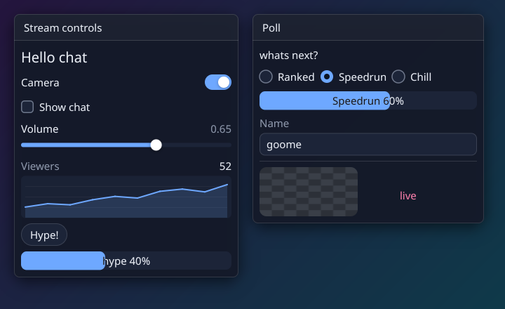
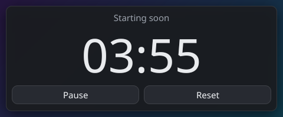
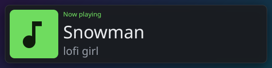
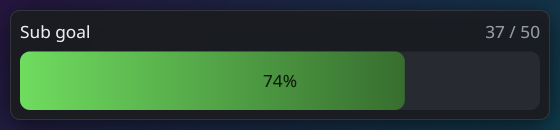
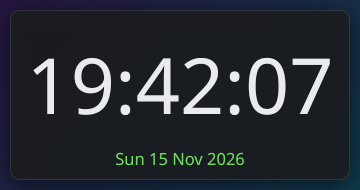
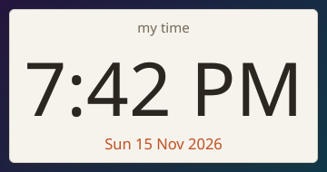
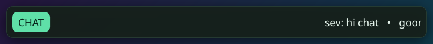
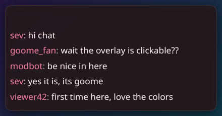

<p align="center">
  
</p>

<h1 align="center">🎥 obs-goome 🎥</h1>

<p align="center">
<b>A goome ui as an OBS source. Timers, now playing, goal bars, clocks, chat tickers, or anything you make in the builder, and you can click it.</b>
</p>

<p align="center">
  
  
  
  
  
  
  
</p>

<p align="center">
  <a href="https://goome.wtf/docs/">Docs</a> &nbsp;·&nbsp;
  <a href="https://goome.wtf/builder/">Builder</a> &nbsp;·&nbsp;
  <a href="https://github.com/goome-ui/examples">Examples</a> &nbsp;·&nbsp;
  <a href="https://github.com/goome-ui/c-goome">C</a> &nbsp;·&nbsp;
  <a href="https://github.com/goome-ui/python-goome">Python</a> &nbsp;·&nbsp;
  <a href="https://github.com/goome-ui/csharp-goome">C#</a>
</p>

<p align="center">
  This is an OBS Studio plugin that adds a <b>goome overlay</b> source. It draws a <a href="https://github.com/goome-ui/c-goome">goome</a> ui offscreen at the size of the source and hands OBS a texture every frame, only copying the part that changed.<br>
  Pick one of the built in widgets streamers always end up needing, or point it at a <code>.goome.json</code> you made in the <a href="https://goome.wtf/builder/">builder</a>.<br>
  Right click the source and hit <b>Interact</b> and the buttons, toggles and sliders all work live, even while you're streaming.<br> <br>
  Do you like this project? If so, please let me know!
  <a href="https://sevvy-wevvy.com/discord">Discord</a>
</p>

<p align="center">
  <br>
  <sub>a builder file with two windows, after clicking Hype! once. every picture here is a real frame from the plugin, made by the test harness</sub>
</p>

<details>
<summary align="center"><b>⬇️ Install ⬇️</b></summary>

<br>

<p align="center">
Grab the file for your OS from the <a href="https://github.com/goome-ui/obs-goome/releases/latest">latest release</a>.<br>
It needs OBS Studio 31 or newer. Close OBS before you install it.
</p>

<h3 align="center">🪟 Windows</h3>

<p align="center">
Download <code>obs-goome-…-windows-x64-installer.exe</code> and run it. It puts the plugin in <code>C:\ProgramData\obs-studio\plugins\obs-goome</code>, thats the folder OBS looks in for plugins, and you can uninstall it from Settings > Apps like anything else. Its not signed, so if SmartScreen pops up click More info, then Run anyway.<br> <br>
Rather not run an installer? Download <code>obs-goome-…-windows-x64.zip</code> and unzip it into <code>C:\ProgramData\obs-studio\plugins</code>, so you end up with <code>C:\ProgramData\obs-studio\plugins\obs-goome\bin\64bit\obs-goome.dll</code>. Make the folder if its not there yet.
</p>

<h3 align="center">🍎 macOS</h3>

<p align="center">
Download <code>obs-goome-…-macos-universal.pkg</code> and open it, it puts the plugin in the right place. It isnt signed yet, so if macOS blocks it right click it, pick Open, then Open again.<br>
It runs on Apple Silicon and Intel.
</p>

<h3 align="center">🐧 Linux</h3>

<p align="center">
On Ubuntu / Debian download <code>obs-goome-…-x86_64-linux-gnu.deb</code> and install it:
</p>

```sh
sudo apt install ./obs-goome-*-x86_64-linux-gnu.deb
```

<p align="center">
Its built against the OBS from the <a href="https://launchpad.net/~obsproject/+archive/ubuntu/obs-studio">OBS PPA</a>, so it wants that OBS or a newer one.<br>
On other distros you can pull the files out of the .deb without installing it:
</p>

```sh
mkdir deb && dpkg-deb -x obs-goome-*-x86_64-linux-gnu.deb deb    # or: ar x the.deb && tar xf data.tar.*
mkdir -p ~/.config/obs-studio/plugins/obs-goome/bin/64bit ~/.config/obs-studio/plugins/obs-goome/data
cp deb/usr/lib/*/obs-plugins/obs-goome.so ~/.config/obs-studio/plugins/obs-goome/bin/64bit/
cp -r deb/usr/share/obs/obs-plugins/obs-goome/* ~/.config/obs-studio/plugins/obs-goome/data/
```

<p align="center">
The Flatpak version of OBS cant load plugins from outside the flatpak, so this wont show up there.
</p>

<p align="center">
After that, open OBS, add a source and pick <b>goome overlay</b>.
</p>
</details>

<details>
<summary align="center"><b>🧩 The Widgets 🧩</b></summary>

<br>

<p align="center">
<b>Show</b> at the top of the source settings picks what it draws. Every one of them has a theme, an accent color, a UI scale, a font and the card behind it in the same settings.
</p>

<h3 align="center">⏱️ Timer</h3>

<p align="center">
  <br>
  <b>Counts</b> - down (a countdown) or up (a stopwatch)<br>
  <b>Minutes / Seconds</b> - how long the countdown is<br>
  <b>Label</b> - the small line on top, like "Starting soon"<br>
  <b>Text when it hits 0</b> - shows up in the accent color when the countdown ends<br>
  <b>Show Start and Reset buttons</b> - turn it off if you dont want the buttons on stream<br>
  <b>Start / Pause</b> and <b>Reset</b> - also in the settings, so it works without Interact too
</p>

<h3 align="center">🎵 Now Playing</h3>

<p align="center">
  <br>
  <b>Song file</b> - a text file your music app or a tool like Tuna or Snip writes. The first line is the song, the second line the artist<br>
  <b>Label</b> - the green line, "Now playing" by default<br>
  <b>Text when the file is empty</b> - "nothing playing" by default<br>
  It checks the file every second. Long names scroll sideways, and Arabic or Hebrew names scroll the other way so you read them from the start. Emoji work too.
</p>

<h3 align="center">🎯 Goal Bar</h3>

<p align="center">
  <br>
  <b>Label</b> - "Sub goal", "Follower goal", whatever<br>
  <b>Numbers come from</b> - these settings (Current and Goal), or a text file<br>
  <b>Goal file</b> - just <code>120</code>, or <code>120/500</code> to set the goal from the file too<br>
  The bar slides to the new value when it changes, with the <b>ease</b> from the theme (so spring and bounce work here too).
</p>

<h3 align="center">🕒 Clock</h3>

<p align="center">
  
  <br>
  <b>24 hour clock</b>, <b>Show seconds</b>, <b>Show the date</b> and a <b>Label</b>. It uses your computers time zone.
</p>

<h3 align="center">💬 Ticker / Chat</h3>

<p align="center">
  <br>
  <br>
  <b>Text file</b> - newest line at the bottom, like a chat log a bot writes. It only reads the end of the file, so a huge log is fine<br>
  <b>Style</b> - one scrolling line, or chat lines stacked from the bottom. <code>name: message</code> lines get the name in the accent color<br>
  <b>Scroll speed</b> / <b>Lines to show</b> - for the two styles<br>
  Every line keeps its own direction, so an English line next to an Arabic one still reads right. If the oldest line is right to left the whole ticker scrolls the other way
</p>
</details>

<details>
<summary align="center"><b>🛠️ Builder Files 🛠️</b></summary>

<br>

<p align="center">
1. Open the <a href="https://goome.wtf/builder/">builder</a>, drag your ui together and hit <b>Save project (.goome.json)</b> in the menu<br>
2. In the source settings set <b>Show</b> to <b>A builder file</b> and pick that file<br>
3. Leave <b>Theme</b> on <b>From the builder file</b> to keep your builder theme, or pick a preset to swap it<br> <br>
The motion keys (anim_ms, ease, hover_ms and the rest) come through as well. The builder saves ease as a number, if you edit the json by hand you can also write the name like <code>"spring"</code> or <code>"GOOME_EASE_BOUNCE"</code>.<br>
Save the file again from the builder and the source reloads it by itself, no need to touch OBS. Window positions in the builder are pixels from the top left of the source.<br>
<code>examples/stream.goome.json</code> is the one in the big picture up top.
</p>

<p align="center">
The plugin reads the file in C and turns it into goome ui calls, it doesnt run the generated code. What it draws:<br> <br>
<b>Layout</b> - windows (move, resize, collapse, no title, close), rows, same line, space, separators, scroll areas, tabs, collapsing sections, tree nodes<br>
<b>Text</b> - labels, headings, wrapped text, with <code>{var}</code> in them filled in live<br>
<b>Input</b> - buttons, checkboxes, toggles, radio groups, sliders, int sliders, inputs (password, number, hint), combos, selectable lists, color pickers<br>
<b>Data</b> - progress bars, tables, line and bar plots, images<br>
<b>Menus</b> - menu bars, menus, menu items, popups, modals<br>
<b>Looks</b> - the project theme with every color and size, secondary themes and presets in styles, per widget style overrides (colors, sizes, corner radii), widths and pos/size<br>
<b>Logic</b> - project vars and binding widgets to them, and the actions on click / change / on / off / hover: set, flip, add, take, open, close, toast, switch tab and copy<br> <br>
Not yet: custom elements, split panes, the multiline text editor, skin and icon images in themes, hotkeys and the ui config. They get skipped and the OBS log says how many.<br>
The builder doesnt save pixels for image widgets, so they draw as a checker box. Add <code>"file": "logo.png"</code> (next to the json) or a <code>data:</code> url as <code>"img"</code> to the widget in the json and it draws that.
</p>
</details>

<details>
<summary align="center"><b>🖱️ Clicking It 🖱️</b></summary>

<br>

<p align="center">
Right click the source (in the scene or the sources list) and pick <b>Interact</b>. OBS opens a window with the source in it, and clicks, mouse moves, the scroll wheel and your keyboard go straight into goome.<br>
So the timer buttons, builder buttons, toggles, sliders and text inputs all work, and what you change shows up on stream right away.<br> <br>
OBS doesnt let a source change the mouse cursor, so the cursor stays an arrow over inputs.<br> <br>
Accents from dead keys, compose and other keyboard layouts go in fine, the plugin hands them to goome as finished text. A real IME (Japanese, Chinese, Korean) wont work in there though, the OBS Interact window only sends key presses and never the input method text, so theres no preedit either. Type it somewhere else and paste it.
</p>
</details>

<details>
<summary align="center"><b>🎨 Themes 🎨</b></summary>

<br>

<p align="center">
<b>Theme</b> has all the goome presets: goome dark, goome light, Midnight, Paper, Mint, High contrast and Rose. The clock above is on Paper, the ticker on Mint and the chat on Rose.<br>
<b>Use my own accent color</b> swaps just the accent, <b>UI scale</b> makes everything bigger or smaller, and <b>Font</b> takes a system font name, a path to a .ttf, or <code>builtin</code> for the font built into goome.<br>
System fonts and .ttf paths get your systems emoji font (and an Arabic / Hebrew one if the font doesnt have those) added behind them, so emoji just show up. <code>builtin</code> has no emoji.<br>
Turn off <b>Draw the card behind it</b> and only the text and widgets show, straight on top of your scene.
</p>
</details>

<details>
<summary align="center"><b>🧪 Testing 🧪</b></summary>

<br>

<p align="center">
<code>tests/harness.c</code> runs the real source code (it includes <code>src/goome-source.c</code> as is) against a fake libobs in <code>tests/shim/</code>. It makes every widget, drives them through the same <code>obs_source_info</code> callbacks OBS calls, clicks and types through the Interact callbacks, and reads back the texture the source uploaded.<br>
Every render gets a pixel hash that has to match <code>tests/hashes.txt</code>, and the texture that got built from the dirty rects has to match a full copy of the goome frame byte for byte.
</p>

```sh
tests/run.sh check     # build the harness and check the hashes
tests/run.sh print     # print the hashes
tests/run.sh shots     # write a .ppm of every render with your system font, thats where the pictures here come from
```

<p align="center">
The hashes use goome's built in font and a fixed clock so they come out the same on every OS. CI runs them on Linux, Windows and macOS.<br>
The emoji, RTL and typing tests use <code>tests/colorfont.ttf</code> instead, its the tiny made up color font from c-goome's <code>tests/mkfonts.py</code> (same license as goome) so the emoji dont depend on whatever emoji font your OS has.<br>
CI also builds the real plugin on all 3 and, on Linux, loads it into a real libobs with OpenGL under Xvfb (<code>tests/obs_render.c</code>), draws the timer, clicks Start through <code>obs_source_send_mouse_click</code> and checks the frame changed.
</p>
</details>

<details>
<summary align="center"><b>🔨 Building It Yourself 🔨</b></summary>

<br>

<p align="center">
It uses the <a href="https://github.com/obsproject/obs-plugintemplate">obs-plugintemplate</a> layout, so the scripts in <code>.github/scripts</code> fetch the OBS sources and prebuilt deps for you on Windows and macOS. On Linux you need OBS and its headers installed (the OBS PPA, or <code>libobs-dev</code>) plus <code>libsimde-dev</code>.
</p>

```sh
cmake --preset ubuntu-x86_64      # or macos / windows-x64
cmake --build --preset ubuntu-x86_64
```

<p align="center">
Or just push to a fork, CI builds and packages it for all 3.
</p>
</details>

<details>
<summary align="center"><b>🔧 Updating goome 🔧</b></summary>

<br>

```sh
tools/update_native.sh ../c-goome      # or a path to any goome.h, or nothing to clone main
tests/run.sh check
```

<p align="center">
<code>native/goome.h</code> is the one file version of goome and <code>native/VERSION</code> keeps the commit it came from. If a hash moves after that, look at the shots before you touch <code>tests/hashes.txt</code>.
</p>
</details>

<details>
<summary align="center"><b>🛠 Pull Requests 🛠</b></summary>

<br>

<p align="center">
Want to help with obs-goome? Make A pull request to <b>dev</b>!<br>
Small fixes are the easiest to merge, for anything bigger open an issue first so we can talk about it. Bugs in goome itself go to <a href="https://github.com/goome-ui/c-goome">c-goome</a>.<br> <br>
As long as it works and doesn't add a dependency its very likely to get accepted!<br>
Read <a href="CONTRIBUTING.md">CONTRIBUTING.md</a> before you send one.
</p>
</details>

<details>
<summary align="center"><b>⚖️ License ⚖️</b></summary>

<br>

<p align="center">
obs-goome is under the <a href="LICENSE">GPL-3.0</a>.<br> <br>
OBS Studio is GPL-2.0-or-later, so it can be used under the GPL-3.0 too, and goome is GPL-3.0. That makes the whole plugin GPL-3.0. The <code>cmake/</code> files and <code>.github/scripts</code> come from obs-plugintemplate (GPL-2.0-or-later) and go out under the GPL-3.0 here as well.<br> <br>
<sub>
• You can use it, change it and share it<br>
• If you share something made with it, you have to share your source too, under the same license<br>
• Keep the credits
</sub><br> <br>
In short: play fair, keep it open, and give credit where it's due.
</p>
</details>

<details>
<summary align="center"><b>🩷 Donate 🩷</b></summary>

<br>

<p align="center">
<a href="https://sevvy-wevvy.com/kofi">Ko-fi</a> (Preferred)<br>
<a href="https://sevvy-wevvy.com/patreon">Patreon</a><br>
<a href="https://sevvy-wevvy.com/throne">Throne</a>
</p>
</details>

<p align="center">
<b>🫶 Contributors 🫶</b><br>
Thanks to everyone who helped out!<br> <br>
<a href="https://github.com/goome-ui/obs-goome/graphs/contributors"></a>
</p>
